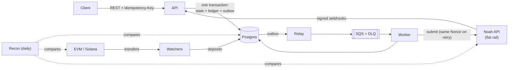

# Ferry

[](https://github.com/darkodi/ferry/actions/workflows/ci.yml)

A security-first stablecoin payout engine in Go. A business deposits USDC on-chain (an EVM testnet or Solana devnet), then asks for a fiat payout to a bank account. Ferry quotes the payout through a fiat rail, holds the funds, submits the payout, follows it to settlement or a bank return, and records every step in a double-entry ledger. The rail is the Noah Business API: Ferry is its client, not a copy of it.

Ferry is a portfolio project by a blockchain security auditor learning production Go. The reasoning matters as much as the code: [`docs/design.md`](docs/design.md) covers the design and its decisions, [`docs/threat-model.md`](docs/threat-model.md) the threats, and [`docs/self-audit.md`](docs/self-audit.md) the issues found in Ferry's own code.

## What it guarantees

- **Money is never created, lost or paid twice.** Every balance change is a balanced journal entry. Postgres itself refuses unbalanced entries, overdrafts and edits to posted history. The application's database role can't update or delete history at all.
- **Retries are safe everywhere.**
  - API calls take an `Idempotency-Key`.
  - Queue consumers deduplicate in the same transaction as their effect.
  - The Nonce sent to the rail is saved before the call and reused on retry, so a timeout can't cause a second payout.
- **Any process can crash at any point.** State, ledger entries and the "what happens next" message commit in one transaction ("write first, act second"). A resolver drives unknown outcomes to a known state.
- **Outside input is untrusted.**
  - Webhooks are signature-verified, stored, and only trigger a re-fetch from the rail.
  - Deposits are credited only after confirmations, and reorgs are handled.
  - Every amount is parsed exactly, never as a float.
- **Ledger, chain and rail are reconciled.** A daily job compares them and reports every disagreement as a break. It never edits money itself.
- **Keys don't leave KMS on AWS.** Noah request signing (P-384), the Solana authority (Ed25519) and the bank-details data key live in AWS KMS. Each key policy names the exact services that may use it.

## Architecture



| Binary | Job |
| --- | --- |
| `api` | REST API, idempotency, quotes, holds, inbound webhooks |
| `relay` | Outbox → SQS |
| `worker` | Submits payouts to the rail; the resolver re-drives unknown outcomes |
| `watcher` | One per chain: detects deposits, waits for confirmations, handles reorgs; on Solana it also creates deposit accounts |
| `recon` | Reconciles ledger, chain and rail |
| `migrate` | Applies migrations and creates the services' least-privilege database login |

## Status

All seven milestones are built:

| Milestone | Built |
| --- | --- |
| M1 Ledger core | Schema enforced by Postgres, posting rules, invariants, a concurrent overspend test |
| M2 Payouts | State machine, holds, mock rail, HTTP API with API keys and `Idempotency-Key` |
| M3 Events | Transactional outbox, relay to SQS, idempotent worker, resolver |
| M4 Chains | EVM (xpub addresses, reorgs) and Solana (seed-derived token accounts) deposits |
| M5 Noah rail | Encrypted saved bank accounts, ES384-signed adapter, verified webhooks, bank returns |
| M6 Recon + ops | Reconciliation and breaks, verified treasury top-ups, Prometheus metrics, OpenTelemetry traces, alerts, Grafana dashboard |
| M7 AWS | Keys in KMS, one signed distroless image, Terraform with offline checks in CI |

What hasn't run against the real thing yet:

- **The Noah sandbox.** No API key yet; a fake server built from Noah's documented API stands in, and a sandbox contract test is ready.
- **The AWS stack.** Written and checked, not applied.

Designed but not built: the treasury sweep out of deposit addresses, per-key API scopes, and outbound customer webhooks. See the threat model's residual risk register.

## Quickstart

You need Go (the version in `go.mod`), Docker and make.

```bash
cp .env.example .env
sed -i "s|^FERRY_ADMIN_KEY=$|FERRY_ADMIN_KEY=$(openssl rand -hex 32)|; s|^FERRY_DATA_KEY=$|FERRY_DATA_KEY=$(openssl rand -base64 32)|" .env
make up && make migrate   # Postgres, ElasticMQ (SQS), Anvil, a Solana test validator
make run                  # the API; in dev mode also the relay, worker and resolver, with the mock rail
```

Everything binds to 127.0.0.1. If port 5432 is taken, set `POSTGRES_PORT` and the port in `DATABASE_URL` in `.env`.

### A deposit and a payout

In another terminal, run `make chain-setup` (test USDC on both local chains) and `make watcher` (the EVM deposit watcher). Then:

```bash
source .env; B=http://127.0.0.1:8080/v1

# 1. A customer (operator call). The api_key is shown once.
curl -s -X POST $B/customers -H "Authorization: Bearer $FERRY_ADMIN_KEY" -d '{"name":"Acme"}'
CID=...; KEY=ferry_sk_...

# 2. Fund it on-chain: 200 TestUSDC to its deposit address. It shows as pending, then
#    confirmed two blocks later, and the balance becomes 200.
curl -s $B/customers/$CID/deposit-addresses -H "Authorization: Bearer $KEY"
TO=0x...
docker compose exec -T anvil cast send --rpc-url http://localhost:8545 --unlocked \
  --from 0xf39Fd6e51aad88F6F4ce6aB8827279cffFb92266 $FERRY_EVM_USDC_ADDRESS \
  "transfer(address,uint256)" $TO 200000000
curl -s $B/customers/$CID/deposits -H "Authorization: Bearer $KEY"
#    (No chain? POST $B/dev/deposits {"customer_id":"...","amount":"200"} with the operator key.)

# 3. A bank account. The response shows only "BankAch ****6789"; the details are encrypted.
curl -s -X POST $B/destinations -H "Authorization: Bearer $KEY" -H "Idempotency-Key: dest-1" -d '{
  "country":"US","fiat_currency":"USD","payment_method_type":"BankAch",
  "form":{"AccountHolderAddress":{"Address":"1 Main St","City":"New York","State":"NY","PostalCode":"10001"},
          "BankDetails":{"AccountNumber":"000123456789","BankCode":"021000021","AccountType":"Checking"},
          "PaymentPurpose":"Invoice"}}'
DID=...

# 4. A 100.00 USD payout. The quote authorizes up to 101.50 USDC.
curl -s -X POST $B/payouts -H "Authorization: Bearer $KEY" -H "Idempotency-Key: order-1" \
  -d "{\"fiat_amount\":10000,\"fiat_currency\":\"USD\",\"destination_id\":\"$DID\"}"
PID=...

# 5. Confirm: 101.50 is held, the worker submits, the mock rail settles.
curl -s -X POST $B/payouts/$PID/confirm -H "Authorization: Bearer $KEY" -H "Idempotency-Key: confirm-1"
curl -s $B/payouts/$PID -H "Authorization: Bearer $KEY"              # settled
curl -s $B/customers/$CID/balances -H "Authorization: Bearer $KEY"   # 99.50: 100 paid + 0.50 fee; the 1.00 buffer came back
```

Send step 4 again with the same key, and you get the same payout with `Idempotent-Replayed: true`. On Solana, the customer's `solana-local` address becomes `active` once `make watcher-solana` has created its token account. Copy the Solana values `make chain-setup` printed into `.env` first.

### Through the Noah adapter

The same flow with separate processes and the Noah adapter against a local fake built from Noah's documented API:

```bash
make fake-noah            # 127.0.0.1:18090
# .env: FERRY_ENV= (empty), FERRY_RAIL=noah, NOAH_BASE_URL=http://127.0.0.1:18090/v1,
#       NOAH_API_KEY=fake-noah-key, FERRY_RESOLVER_STALE=5s
make run; make relay; make worker   # one terminal each
```

Ferry pays from its pre-funded Noah balance. Fund it first:

1. `curl -X POST localhost:18090/_control/credit/200` at the fake returns a transaction ID.
2. Book it with `POST /v1/admin/treasury-topups {"rail_tx_id":"<ID>"}`. Ferry reads the amount from Noah.

A confirmed payout then reaches `submitted`. To finish it, call `POST localhost:18090/_control/transactions/<ID>/settle` (or `fail`, or `reverse` for a bank return); the resolver picks it up.

With signed webhooks, the payout settles within a second instead: give the fake `FAKE_NOAH_WEBHOOK_URL` and `FAKE_NOAH_WEBHOOK_KEY`, and give Ferry `NOAH_WEBHOOK_PUBLIC_KEY`. [`docs/demo.md`](docs/demo.md) has the full script.

With a real sandbox key, point `NOAH_BASE_URL` at `https://api.sandbox.noah.com/v1`, and run the contract test first:

```bash
NOAH_API_KEY=... go test ./internal/rail/noah -run Sandbox -v                       # channels + prepare
NOAH_API_KEY=... NOAH_SANDBOX_SELL=1 go test ./internal/rail/noah -run Sandbox -v  # also a 1 USD sale
```

### Reconciliation

`make recon` runs one reconciliation: ledger invariants, each chain's deposit addresses, and (with `FERRY_RAIL=noah`) Noah's transactions and balance. Anything that disagrees becomes a break:

- list them with `GET /v1/admin/recon-breaks`;
- explain one with `POST /v1/admin/recon-breaks/{id}/resolve`, which never moves money.

### Observability

`make obs-up` starts three services:

- Prometheus at <http://127.0.0.1:9090>, with Ferry's 18 alert rules;
- Grafana at <http://127.0.0.1:3000>, with the provisioned *Ferry* dashboard;
- Jaeger at <http://127.0.0.1:16686>.

Set `OTEL_EXPORTER_OTLP_ENDPOINT=http://127.0.0.1:4318` to export traces. One payout's trace runs from the API's confirm request through the outbox, queue and worker to the Noah HTTP call. Log lines carry `trace_id`.

<!-- Screenshot: Grafana "Ferry" dashboard during docs/demo.md (docs/img/dashboard.png). -->

## On AWS

[`deploy/terraform`](deploy/terraform/README.md) runs Ferry on AWS:

- ECS Fargate services behind an ALB with WAF;
- RDS Postgres (TLS, verified), SQS with a DLQ;
- KMS keys, Secrets Manager;
- CloudWatch alarms to SNS, and X-Ray traces through ADOT sidecars.

Each task has its own IAM role, and each key policy names the exact roles that may use that key.

Deploys run one image built by CI: distroless and non-root, signed keylessly with cosign, with an SBOM, scanned with Trivy. `make aws-up` deploys only the digest whose signature it has verified.

`make tf-check` validates, tests (against a mocked AWS provider), lints and policy-scans the Terraform without credentials, and CI runs the same. The stack has not been applied yet; it costs roughly 100–150 USD a month while running.

```bash
cosign verify ghcr.io/darkodi/ferry:main \
  --certificate-identity-regexp 'https://github.com/darkodi/ferry/.github/workflows/ci.yml@refs/heads/main' \
  --certificate-oidc-issuer https://token.actions.githubusercontent.com
```

## Development

```bash
make test       # go test -race ./... (integration tests use Docker; -short skips them)
make lint       # go vet, golangci-lint (with gosec), govulncheck
make gitleaks   # secrets in history and working tree
make tf-check   # Terraform: fmt, validate, test, tflint, checkov
make image      # the container image, as ferry:local
make help       # every target
```

Tools are pinned and installed into `./bin` on first use, or run in containers pinned by digest.

| Path | What's there |
| --- | --- |
| `cmd/` | the six binaries |
| `internal/ledger`, `payout`, `outbox`, `inbox`, `idempotency` | the money core |
| `internal/chain` (`evm/`, `solana/`), `internal/rail` (`noah/`, `mock/`) | adapters to the outside world |
| `internal/recon`, `treasury`, `destination`, `customer`, `api` | everything else in the domain |
| `internal/platform` | db, queue, observability, KMS |
| `migrations/` | goose SQL, embedded in `migrate` |
| `deploy/` | Prometheus, Grafana, ElasticMQ, RDS CA bundle, Terraform |
| `docs/` | design, threat model, self-audit, demo script |

## License

See [LICENSE](LICENSE).
