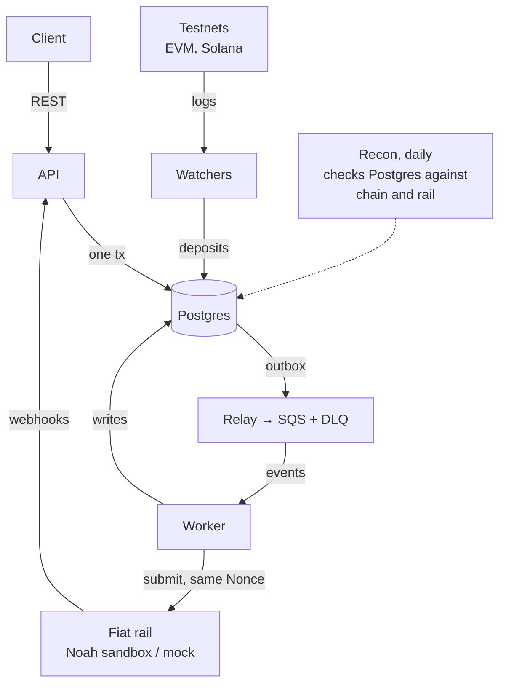
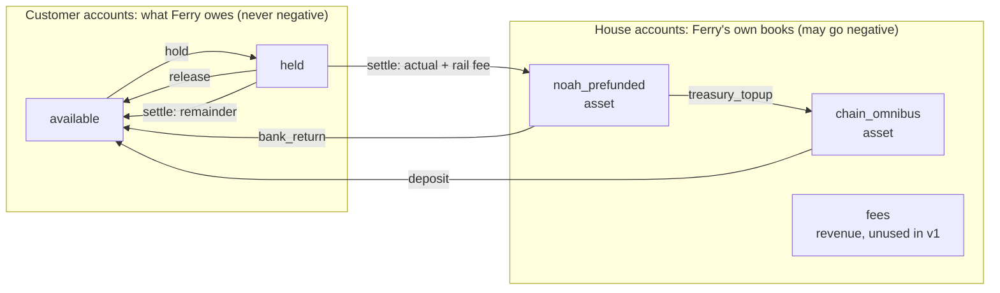
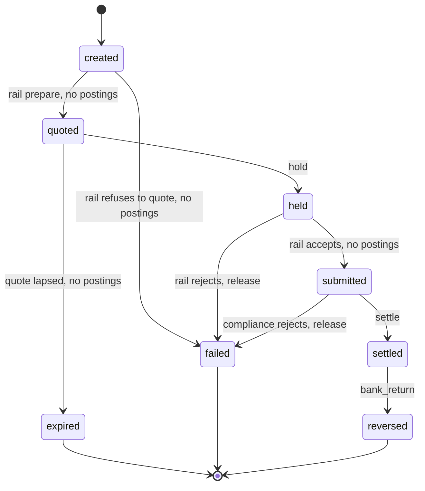

# Payout Engine — Architecture & Design Doc

## Overview

**Ferry** is a small stablecoin payout engine in Go. A business funds a balance with USDC (EVM testnet or Solana devnet), then requests a fiat payout to a bank account; Ferry quotes it, reserves funds, executes it through a fiat rail, and settles the ledger. It is a portfolio project that mirrors the core of a stablecoin payments platform: orchestration, ledgering, settlement, rail integration, reconciliation.

### Goals

- **Money is never created, lost or double-spent.** Every balance change is a balanced double-entry journal; invariants are checked in code and in tests.
- **Every external effect is idempotent.** Client retries, worker crashes and duplicate messages never cause a second payout.
- **Crash-safe at every step.** Any process can die between any two lines; the system resumes from persisted state.
- **Multi-chain deposits.** USDC deposits detected on one EVM testnet and Solana devnet, with confirmation depth and reorg handling.
- **Real rail integration.** One fiat rail via the Noah sandbox API, plus a mock rail for failure injection.
- **Reconciled and observable.** A daily job proves ledger = chain = rail; metrics and traces show where every payout is.
- **Shipped on AWS** with Terraform, in a form a reviewer can run locally with one command.

### Non-goals

- Real funds, mainnet, or production licences.
- Full KYC/KYB. A stub compliance check marks the place where screening would sit.
- FX engine. Quotes come from the rail; Ferry only stores and enforces them.
- High availability across regions. One region, horizontally scalable workers.

## Architecture

Five Go binaries share one Postgres database; nothing talks to the outside world inside a transaction.



When a request comes in, the API (or a chain watcher that spots a deposit) saves everything in Postgres in one go: the new status, the accounting entries, and a note saying “something needs to happen next.” The note is the outbox row, and it is saved together with the rest, so it can’t be lost.

The relay is a small helper that reads those notes and puts each one on an SQS queue, which is a waiting line for jobs. The worker picks jobs off the queue, calls the payment partner (the rail), and writes the outcome back to Postgres.

Recon is the daily checker. It reads what Ferry has recorded in Postgres and compares it with what the blockchain and the rail report, and it flags any mismatch.

| Binary | Responsibility | Scales by |
| --- | --- | --- |
| `api` | REST endpoints, idempotency, quotes, holds, inbound webhooks | Stateless replicas |
| `worker` | Submit to rail, settle, resolve unknown outcomes | Replicas; SQS distributes |
| `relay` | Outbox → SQS | 1–2 replicas, `SKIP LOCKED` |
| `watcher` | One per chain; deposit detection, confirmations, reorgs | One active per chain (leader lock in Postgres) |
| `recon` | Daily reconciliation, invariant checks | Scheduled task |

## Domain model

The ledger is the source of truth; every other table is a workflow record that points into it. Balances are derived from postings, never stored as mutable numbers without a matching journal.

### Ledger

The ledger is three tables: `accounts` holds the current balances, `journal_entries` records what happened, and `postings` records exactly how much moved where. Everything below follows one story: customer Acme deposits 100 USDC, then starts a payout that reserves 50.20 USDC.

Amounts are stored as whole numbers of millionths of a USDC, so 100 USDC is `100000000`.

#### 1. `accounts`: who holds what, right now

One row per account. Each customer has two (`available` and `held`); Ferry's own "house" accounts have no owner. Every row carries its current balance in `posted`, so there is no separate balances table to keep in sync.

| id | owner | kind | currency | posted |
| --- | --- | --- | --- | --- |
| 1 | none (house) | `chain_omnibus` | USDC | 100000000 |
| 2 | none (house) | `noah_prefunded` | USDC | 0 |
| 3 | none (house) | `fees` | USDC | 0 |
| 4 | Acme | `available` | USDC | 49800000 |
| 5 | Acme | `held` | USDC | 50200000 |

The `posted` values show the balances after the two entries described below. A customer account can never go negative: Go checks this after locking the rows, and the database refuses it too. House accounts may go negative, because they mirror real balances that Ferry does not control; the invariant job raises an alert instead. The database also refuses a customer account without an owner, a house account with an owner, and a second `available` account for the same owner.

#### 2. `journal_entries`: what happened

One row per business event. It says what happened and why, but carries no amounts.

| id | idempotency key | type | ref id | reverses |
| --- | --- | --- | --- | --- |
| 1 | `deposit:evm-sepolia:0xab12:3` | `deposit` | the deposit | none |
| 2 | `payout:9f1c:hold` | `hold` | the payout | none |

- The **idempotency key** is unique and built from the event itself (see Entry types), so processing the same event twice fails on the second insert and money cannot be posted twice. It is unrelated to the client's `Idempotency-Key` header.
- The **type** is one of the seven in Entry types.
- **Reverses** is used only by a `correction` that exactly mirrors an earlier entry. Each entry can be mirrored once.

#### 3. `postings`: the money lines

Each entry has at least two lines. A line says which account is debited or credited, and by how much.

| id | entry | account | direction | amount |
| --- | --- | --- | --- | --- |
| 1 | 1 | 1 (`chain_omnibus`) | debit | 100000000 |
| 2 | 1 | 4 (`available`) | credit | 100000000 |
| 3 | 2 | 4 (`available`) | debit | 50200000 |
| 4 | 2 | 5 (`held`) | credit | 50200000 |

An amount is always positive; the direction gives the sign. Within one entry, the debits must equal the credits for each currency. Go checks this before inserting, and the database checks it again when the transaction commits. A posting's currency must match its account's.

#### How they work together

To record an event, one database transaction adds the journal entry, adds its postings, and updates `posted` on every account it touches. If any step fails, nothing is saved. A `posted` value always equals the sum of that account's postings, and the invariant job verifies it. Customer accounts count up when credited; the house assets count up when debited, and Go keeps one small lookup from kind to that side.

#### What can never change

Postings and journal entries cannot be edited or deleted, not by the app and not even by the database owner. A mistake is fixed by adding a `correction` entry. The app role (`ferry_app`) can add entries and postings, open accounts, and change only `posted` and `updated_at` on an account.

### Account kinds

| Kind | Owner | Nature | Normal side | May go negative | Meaning |
| --- | --- | --- | --- | --- | --- |
| `available` | customer | liability | credit | no | Spendable balance owed to the customer |
| `held` | customer | liability | credit | no | Reserved for a payout in `held` or `submitted` |
| `chain_omnibus` | house | asset | debit | yes | Ferry's USDC on-chain (deposit addresses + omnibus wallet) |
| `noah_prefunded` | house | asset | debit | yes | Ferry's USDC sitting at Noah, the balance payouts are sold from |
| `fees` | house | revenue | credit | yes | Ferry's own fee income (none in v1: no markup is charged) |

A payout is not Ferry's cost: it is the customer's money leaving the system, so settlement reduces a liability (`held`) and an asset (`noah_prefunded`) together.

#### Reading debit and credit

"Debit" and "credit" do not mean "decrease" and "increase". They mean left side and right side of an entry, and what each does to a balance depends on the account's nature:

| Nature | Examples | Debit | Credit |
| --- | --- | --- | --- |
| Asset: something Ferry has | `chain_omnibus`, `noah_prefunded` | increases | decreases |
| Liability: something Ferry owes | `available`, `held` | decreases | increases |

`posted` is always stored as a positive number on the account's own normal side, so a deposit leaves both `chain_omnibus` and `available` at 100 even though one was debited and the other credited. In the code this is `Kind.NormalSide()`.

Effect of each entry type, with the account's nature in brackets:

| Entry type | Account | Direction | Effect |
| --- | --- | --- | --- |
| `deposit` | `chain_omnibus` (asset) | debit | up: Ferry has more USDC on-chain |
| | `available` (liability) | credit | up: Ferry owes the customer more |
| `treasury_topup` | `noah_prefunded` (asset) | debit | up: more USDC at Noah |
| | `chain_omnibus` (asset) | credit | down: less USDC on-chain |
| `hold` | `available` (liability) | debit | down: less spendable |
| | `held` (liability) | credit | up: more reserved |
| `settle` | `held` (liability) | debit | down: reservation used up |
| | `noah_prefunded` (asset) | credit | down: Noah took actual + rail fee |
| | `available` (liability) | credit | up: unused remainder returns |
| `release` | `held` (liability) | debit | down |
| | `available` (liability) | credit | up |
| `bank_return` | `noah_prefunded` (asset) | debit | up: returned USDC is back at Noah |
| | `available` (liability) | credit | up: customer is credited |

Each entry balances because debits equal credits in amount, even though some balances go up and some go down.

Each arrow below points from the **debited** account to the **credited** account, the notation used throughout this document. For the house assets it can look backwards: in a `treasury_topup` the arrow points `noah_prefunded → chain_omnibus` because Noah's balance is debited (it grows) and the omnibus is credited (it shrinks), while the coins physically move the other way.



### Holds

A payout first reserves the rail's authorized amount: `CryptoAuthorizedAmount` from the rail's prepare step, the most the rail may take after fees and price movement. The money moves from `available` to `held` and stays there while the payout is `submitted`; whether the rail has accepted it is recorded on the payout and in `rail_transactions`, not in the ledger.

At settlement the authorized amount splits three ways: `authorized = actual + rail_fee + remainder`. The actual amount and the rail fee leave through `noah_prefunded` (what Noah took from Ferry's balance); the remainder returns to `available`. Any failure, before or after the rail accepted the payout, releases the whole amount back to `available`. If the bank later returns a settled payout, the returned amount is credited to `available`. Any shortfall (return fees, FX) already left with the settlement, and the customer bears it; if Ferry ever absorbs shortfalls, add a `return_fees` expense account in a migration.

### Entry types

A journal entry is one business event; its `type` says which. Each type has one builder function in `internal/ledger/rules.go`, so the rest of the code never assembles postings by hand.

| `type` | Debit | Credit | Posted when | Idempotency key |
| --- | --- | --- | --- | --- |
| `deposit` | `chain_omnibus` | customer `available` | Deposit reaches its confirmation threshold | `deposit:{chain}:{tx}:{log}` |
| `treasury_topup` | `noah_prefunded` | `chain_omnibus` | USDC is moved from the omnibus wallet to Noah | `topup:{ref}` |
| `hold` | `available` | `held` | Customer confirms a payout (quote still valid) | `payout:{id}:hold` |
| `settle` | `held` (authorized) | `noah_prefunded` (actual + rail fee), `available` (remainder) | Rail reports `Settled` | `payout:{id}:settle` |
| `release` | `held` | `available` | Payout fails: rail rejects at submit, or compliance rejects after review | `payout:{id}:release` |
| `bank_return` | `noah_prefunded` | `available` | Bank returns a settled payout (returned amount only) | `payout:{id}:return:{rail_tx}` |
| `correction` | any | any | A human fixes a mistake or a recon break; sets `reverses_entry_id` when it mirrors one entry | `correction:{ref}` |

A payout has one `release` key, so the ledger itself guarantees it is released at most once. Submitting to the rail posts nothing.

### Worked example

Continuing with Acme from the tables above (entry 1: 100 USDC deposited; entry 2: 50.20 held). Ferry tops up its Noah balance with 60, then the rail settles the payout with actual 49.50, rail fee 0.30 and remainder 0.40 (50.20 = 49.50 + 0.30 + 0.40). Amounts are shown in USDC.

| Entry | Account | Debit | Credit |
| --- | --- | --- | --- |
| 3 `treasury_topup` | `noah_prefunded` | 60.00 | |
| 3 | `chain_omnibus` | | 60.00 |
| 4 `settle` | `held` | 50.20 | |
| 4 | `noah_prefunded` | | 49.80 |
| 4 | `available` | | 0.40 |

Each entry balances: 60.00 = 60.00, and 50.20 = 49.80 + 0.40. Balances after each step, each counted on the account's normal side:

| After | `chain_omnibus` | `noah_prefunded` | `available` | `held` |
| --- | --- | --- | --- | --- |
| entries 1 and 2 (the accounts table above) | 100.00 | 0 | 49.80 | 50.20 |
| 3 topup | 40.00 | 60.00 | 49.80 | 50.20 |
| 4 settle | 40.00 | 10.20 | 50.20 | 0 |

The last row shows why the ledger holds together: Ferry's assets (40.00 + 10.20 = 50.20) equal what it owes the customer (50.20). The 49.80 that left Ferry's books is exactly what the customer lost: 49.50 paid out plus 0.30 rail fee.

If entry 3 were skipped, `noah_prefunded` would go to −49.80 at settlement. House accounts may go negative, so the entry still posts, and the invariant job raises an alert.

### Money rules

1. Amounts are integers in minor units (USDC has 6 decimals). No floats anywhere. In Go an amount is an `int64` with overflow-checked arithmetic; the database stores `numeric(38,0)` constrained to the `int64` range.
2. The ledger is USDC-only in v1, enforced by a `CHECK`. Fiat amounts on quotes are metadata, never posted. The Noah adapter maps `USDC` to the sandbox code `USDC_TEST`.

### Workflow records

| Table | Purpose |
| --- | --- |
| `customers` | A business using Ferry: id, name. Its ledger accounts are opened in the same transaction |
| `api_keys` | SHA-256 of each customer API key (keys are random 32 bytes, shown once), revoked\_at |
| `deposit_addresses` | One address per customer and chain, derived from public key material; status `active` or `provisioning` |
| `deposits` | Detected on-chain transfers: chain, tx\_hash, log\_index, block number and hash, amount, status (`pending`, `confirmed`, `orphaned`) |
| `chain_cursors`, `chain_blocks` | Per chain: how far the watcher has scanned, and the hashes of recent blocks for finding a reorg's fork point |
| `quotes` | Rail price for a payout: fiat amount, authorized crypto amount, fee, expires\_at |
| `payouts` | The payout state machine: status, version, needs\_resolution, and the client's idempotency key (unique per customer) |
| `rail_transactions` | One row per rail attempt: nonce, external\_id (= payout id), rail\_tx\_id, status, sub\_status, rfi\_status, last\_event\_version |
| `outbox` | Events written in the same tx as state changes; published\_at, and claimed\_until (the relay's lease) |
| `idempotency_keys` | Client key, request hash, response snapshot, locked\_until |
| `inbox` | Message ids already processed by each consumer |

### Payout state machine

`created → quoted → held → submitted → settled`, plus `reversed` (a settled payout returned by the bank days later), `failed` (rail rejected, or compliance rejected after review) and `expired` (quote lapsed before hold). While `submitted`, the payout carries the rail's sub-status (screening, under review, confirming) and any request for information; a compliance review can keep it there for up to 10 days. So `settled` is not terminal: only `reversed`, `failed` and `expired` are. Transitions are a Go table `map[State][]State`; every transition is a single SQL `UPDATE … WHERE id = $1 AND status = $2 AND version = $3` in the same tx as its ledger entry and outbox event. Zero rows updated means another worker won; the caller stops.

Each transition and the ledger entry posted with it:



## Key flows

Each step below is one database transaction that changes state, writes ledger postings and writes an outbox event together. External calls happen only between transactions, never inside one.

### Deposit (USDC in)

1. Chain watcher sees a USDC `Transfer` (EVM) or token transfer (Solana) to a customer's deposit address.
2. Insert `deposits` row keyed by `(chain, tx_hash, log_index)` with status `pending`. Duplicate detection is the unique key.
3. When confirmations reach the chain's threshold (0 on Solana, which reads only finalized slots), check that the deposit's block hash is still the one on the chain, then mark `confirmed` and post a `deposit` entry and the `deposit.confirmed` event in one transaction. If the hash changed, orphan the deposit and rescan from just before its block.
4. If the block is reorged out before confirmation, mark `orphaned`; nothing was posted, so nothing to reverse.
5. If the same transfer is included again in a new block (nodes return the transactions of dropped blocks to their mempool), the orphaned row goes back to `pending` at its new block. It is still one deposit, credited at most once.
6. A *confirmed* deposit above a fork point (a reorg deeper than the confirmation depth) is never undone automatically: the watcher logs it, and a human posts a `correction`.

### Payout (USDC out to fiat)

1. **Create.** `POST /payouts` with `Idempotency-Key`. Validate, run the compliance stub, insert `payouts` (`created`).
2. **Quote.** Call the rail's prepare endpoint; store `quotes` with the fiat amount, the authorized crypto amount and `expires_at`; move to `quoted`.
3. **Hold.** Client confirms. In one tx: check the quote is not expired, post a `hold` entry for the authorized amount, move to `held`, emit `payout.held`. Insufficient funds fails here with no side effects.
4. **Submit.** Worker consumes `payout.held`, creates a `rail_transactions` row with a fresh Nonce (stored *before* the call) and `ExternalID = payout_id`, then calls the rail. On acceptance store the rail transaction id and move to `submitted`; no postings, the funds stay in `held`.
5. **Wait.** While the rail reports `Pending`, webhooks update sub-status (screening, review, request for information). Each webhook is applied only if its `EventVersion` is newer than the stored one.
6. **Settle.** Rail reports `Settled`. Post the `settle` entry; move to `settled`; emit `payout.settled`; send customer webhook.

Every rail report, whether from a webhook, a poll or the submit response, goes through one function (`payout.Service.Sync`): it fetches the transaction from the rail and applies only what is newer than the stored `last_event_version`. A webhook only says "look again"; the rail's own answer is what moves money.

`POST /payouts/{id}/confirm` returns once the hold commits (status `held`). Steps 4–6 run in the background: the relay publishes `payout.held`, the worker (`payout.Worker`) submits it, and the client follows the payout with `GET /payouts/{id}`.

The resolver (`payout.Resolver`) handles payouts that stopped moving. It runs every few seconds and never cancels anything; it only asks the rail again:

- **`held` for over a minute.** The submit event was lost or dead-lettered, or the submit outcome was unknown (`needs_resolution`). The resolver calls `Submit` again, which reuses the stored Nonce.
- **`submitted` for over a minute.** A webhook may be missing. The resolver calls `Sync`, which re-fetches the transaction and applies anything newer.

A payout under compliance review keeps being re-fetched and stays `submitted`. The cut-off uses the database clock, the same clock that sets `updated_at`.

Until the Noah rail (M5), the mock rail lives in one process's memory. So in dev, `cmd/api` runs the relay, worker and resolver in-process. `cmd/relay` and `cmd/worker` are the deployable binaries once the rail is shared.

### Failure and reversal

- **Rail rejects at submit** → post `release`, move to `failed`.
- **Compliance rejects after review** (rail status `Failed`, refund to Ferry's pre-funded rail balance) → post `release`, move to `failed`.
- **Quote expires before hold** → move to `expired`; no postings.
- **Bank returns a settled payout** → the rail sends a *new* transaction whose `Reverses` field points to the original. Post `bank_return` for the returned amount; move `settled → reversed`.
- **Submit outcome unknown** (timeout, 5xx) → stay `held`, mark `needs_resolution`. The resolver resends with the **same** Nonce (the rail never creates a second transaction for it), then confirms the result by fetching the transaction and matching `ExternalID`. A new Nonce is generated only after a confirmed `Failed`.

## Correctness

Exactly-once *delivery* is impossible; Ferry gets exactly-once *effects* from three pieces: idempotent API, transactional outbox, idempotent consumers.

### Idempotent API

- Every mutating customer endpoint requires `Idempotency-Key`. Keys are scoped to the customer. Ferry stores `(customer, key, request_hash, locked_until, status, response)`; the hash covers method, path and body.
- Same key + same hash → return the stored response (header `Idempotent-Replayed: true`). Same key + different hash → `422`. Key in flight → `409` with `Retry-After`.
- A request claims its key with a 30-second lease before running. Responses below 500 are stored; after a 5xx the key is unlocked so the client can retry at once.
- The key row is not written in the business transaction: creating a payout calls the rail between two transactions, so there is no single transaction to share. Instead the business tables carry their own unique key (`payouts (customer_id, idempotency_key)`), and confirm is idempotent by state. If Ferry dies after the work but before storing the response, the lease runs out, the retry re-runs the handler, and the handler finds the work already done.

### Transactional outbox

- State change, ledger postings and the outbox row commit together.
- The relay works in three steps, and only the middle one leaves Postgres:
  1. A short transaction claims a batch: it sets a 30-second lease (`claimed_until`) on up to 100 unpublished rows that no other relay holds (`FOR UPDATE SKIP LOCKED`), oldest first.
  2. It publishes them to SQS (ElasticMQ locally), outside any transaction, so a slow queue never holds a database lock.
  3. A second short transaction marks them `published_at`.
- A relay that dies between steps 2 and 3 leaves the lease to run out, and the rows go out again. That duplicate keeps the same message id (the outbox row id), and consumers absorb it. Several relays can run at once; each claims different rows.
- After `queue.MaxReceives` (5) failed deliveries, SQS moves a message to the queue's DLQ.

### Idempotent consumers

- Each consumer records `(consumer, message_id)` in `inbox` in the same tx as its effect; a duplicate hits the unique key and is acked without work (`inbox.Handle`).
- The submit worker is the exception: its effect calls the rail between transactions, so the inbox row cannot share a transaction with it. Exactly-once effect comes from two guards. `Submit` acts only on a payout that is still `held`, and a retried submit reuses the stored Nonce. The inbox row, recorded after the work, only lets a duplicate skip early.
- A delivery is acknowledged only after its work is done. A failure leaves it for redelivery, and after 5 receives it moves to the DLQ (malformed body, unknown payout).
- Inbound rail webhooks are stored in `inbox` before Ferry answers `2xx`; the rail retries failed deliveries (up to 7 times), so an early `2xx` could lose an event.
- Webhook order is not guaranteed. Each `rail_transactions` row keeps `last_event_version`; an event with an older or equal `EventVersion` is stored but not applied.
- Rail calls carry a Nonce generated once per attempt and persisted before the call. Every retry of that attempt reuses it, so the rail cannot create a duplicate. A new attempt (new Nonce) starts only after a confirmed `Failed`.

### Concurrency

- State transitions use optimistic locking (`version`). A ledger entry locks every `accounts` row it touches with `SELECT … FOR UPDATE`, always in ascending account id order to avoid deadlocks, and only then computes the new balances.
- Isolation: `READ COMMITTED` plus explicit row locks; one ledger test runs the suite under `SERIALIZABLE` to catch anomalies. The transaction helper retries on serialization failure (`40001`) and deadlock (`40P01`).

### Invariants (checked in tests and by a periodic job)

- Sum of all postings per currency = 0.
- No customer `available` or `held` balance below 0.
- Each account's `posted` = the sum of its postings on its normal side.
- A customer's `held` balance = sum of authorized amounts of their payouts in `held` or `submitted`.
- Every `settled` payout has exactly one settle entry; every terminal payout has zero remaining hold.
- Every `reversed` payout has exactly one `bank_return` entry, linked to the rail transaction named in `Reverses`.

### Testing strategy

- Table-driven unit tests for the state machine (every allowed and forbidden transition).
- Integration tests on real Postgres via `testcontainers-go`.
- Concurrency test: 100 goroutines submit the same idempotency key, and another 100 overspend one balance; assert one payout and no negative balance. Open every pool connection before releasing the goroutines: otherwise most transactions queue behind connection setup, run one after another, and the race never happens (a version without `FOR UPDATE` passed until this was added).
- Fault injection: a mock rail that times out, returns 5xx, duplicates webhooks and bounces after acceptance; kill workers mid-step and assert invariants after restart.
- Property-based tests (`rapid`) generating random sequences of deposits, payouts and failures, checking invariants after each.

## Blockchain integration

One adapter interface hides chain differences; the rest of Ferry sees only confirmed deposits. M4 builds the read side (`internal/chain.Adapter`); the outbound methods arrive with the treasury sweep.

```go
type Adapter interface {
    Chain() string
    Head(ctx context.Context) (Block, error)
    BlockHash(ctx context.Context, n uint64) (string, error)
    ScanTransfers(ctx context.Context, from, to uint64, watched map[string]uuid.UUID) ([]Transfer, error)
    // later, with the sweep:
    // SendUSDC(ctx context.Context, req SendRequest) (TxRef, error)
    // TxStatus(ctx context.Context, ref TxRef) (TxStatus, error)
}
```

`chain.Watcher` is the chain-agnostic engine around an adapter. Each round it does up to four things:

0. **Provision** (Solana only). It creates the on-chain accounts of addresses still `provisioning` and marks them `active`.
1. **Reorg check.** It compares the stored hash of the cursor block with the chain's.
2. **Scan.** It reads the next block range and stores pending deposits and the new cursor in one transaction.
3. **Confirm.** It verifies each deposit's block hash, then credits it.

A Postgres advisory lock keeps one active watcher per chain; a second copy stands by.

| Concern | EVM testnet (e.g. Sepolia / Base Sepolia) | Solana devnet |
| --- | --- | --- |
| Detect deposits | `eth_getLogs` for USDC `Transfer` to known addresses, in block ranges | `getSignaturesForAddress` (finalized) on each deposit token account, paging back to the scanned slot range, then `getTransaction` once per signature. The credit is the account's USDC balance increase (post minus pre token balance), so `Transfer`, `TransferChecked` and transfers made by other programs all count |
| Transfer identity | `(tx_hash, log_index)` | `(signature, account index in the transaction)`, stored in the same columns |
| Finality | N confirmations (configurable) or the `finalized` tag | `finalized` commitment only, so `Confirmations = 0`: a deposit is credited in the round that first sees it |
| Reorg handling | Store the hash of each scanned range's last block and of every deposit's block; when the cursor block's hash changes, rewind to the newest stored block still on the chain, orphan pending deposits above it and re-scan. Before crediting, re-check the deposit's block hash | Finalized slots cannot be rolled back, so the shared rewind code never fires. A skipped slot has no block; its hash is recorded as `skipped`, which never changes once the slot is finalized |
| Deposit addresses | BIP-32 from an account xpub (`m/44'/60'/0'`): customer *i* gets `xpub/0/i`. Ferry holds only the xpub, so it can compute every address but spend from none | A token account per customer at `createWithSeed(authority, "ferry-<i>", Token program)`. The API computes it from the authority's public key. The watcher creates it and only then marks it `active`. Its token owner is a separate **deposit owner** whose private key Ferry never holds, so the key that creates accounts cannot spend from them |
| Outbound (treasury sweep) | Nonce manager: reserve nonce in Postgres, sign, store raw tx before broadcast, rebroadcast same raw tx | Recent blockhash + durable record of signature before send; re-check status before re-sending |

Design notes:

- **Cursor per chain.** `chain_cursors(chain, last_scanned_block, last_block_hash)` updated in the same tx as inserted deposits, so a crash re-scans and dedups on the unique key.
- **Stuck transactions.** EVM: after a timeout, replace with same nonce and higher fee; record both hashes, settle on whichever lands.
- **Keys.** Local dev keys in env vars; on AWS, KMS for signing (EVM `secp256k1` keys are supported). Never in the database.
- **Scope cut.** Payouts in this project go to fiat via the rail, so on-chain outbound is limited to a treasury sweep from deposit addresses to an omnibus wallet. The sweep is deferred past M4: it needs signing keys, gas top-ups for EVM deposit addresses and a nonce manager, and changes no ledger rule (`chain_omnibus` already covers USDC in deposit addresses).
- **Untrusted RPC.** Every log is re-checked: the contract address, the event signature, the recipient, the block range, `removed`, and an amount that fits int64 minor units. Amounts above it are refused, never truncated.
- **Local chain.** Anvil (docker compose) with `contracts/TestUSDC.sol`, a 6-decimal test token; tests use go-ethereum's in-process simulated backend, whose `Fork` makes real reorgs. For Solana, `solana-test-validator` (Agave image, docker compose and testcontainers) with a 6-decimal test mint from `make chain-setup`.

Solana keys and provisioning:

- **Three keys, one secret.** The *authority* is the seed base of every deposit address and pays account rent. Its keypair file is read only by the Solana watcher (dev key in `.dev/`, KMS in M7). The *deposit owner* is the token owner of every deposit account, and only its key can move deposited USDC. Ferry holds just its public key; the private key belongs to the future sweep. The API needs only the authority's public key. The watcher refuses to start if the owner and the authority are the same key.
- **Provisioning.** The address must hold an initialised token account before USDC can land there. Each round the watcher creates up to 20 missing accounts with `createAccountWithSeed` + `InitializeAccount3` (mint = USDC, owner = deposit owner), waits for confirmation, checks the account, and marks it `active`. It is idempotent: an existing account is only checked (owner program, size, mint, owner, state, no delegate or close authority) and never re-created. A failing address is logged and retried the next round, without stopping the scan.
- **Pre-funded addresses.** Anyone can send SOL to a deposit address before its account exists, and the system program then refuses `createAccountWithSeed`. A bare system account is therefore topped up to rent exemption and turned into the token account with `allocateWithSeed` instead, so a stranger's dust cannot block a customer's address.
- **Provisioning addresses are watched too.** If the watcher stops after creating an account but before marking it `active`, a deposit that lands in between is still found. The status shown by the API tells customers when to send.
- **Address mismatch.** Before creating anything, the watcher recomputes the address from its own authority and the stored derivation index. If the API and watcher are configured with different authorities, it refuses.
- **Untrusted RPC.** A transaction counts only if it succeeded, its first signature is the one asked for, and its slot is in the scanned range. A token balance counts only if its account index is in range and listed once, its mint is the USDC mint, its owner is the deposit owner, its program is the Token program, and its amounts are canonical integers. A credit above the int64 range is refused, never truncated.

## Rail integration (Noah)

Ferry is a client of the Noah Business API: it holds a pre-funded USDC balance at Noah, and each payout is a sell transaction against that balance. Behaviour every rail shares lives in the core; Noah-specific mechanics live only in `internal/rail/noah`.

```go
type Rail interface {
    Prepare(ctx context.Context, req QuoteRequest) (Quote, error)           // authorized amount, expiry
    Submit(ctx context.Context, q Quote, nonce, externalID string) (RailTx, error)
    Get(ctx context.Context, railTxID string) (RailTx, error)
    ParseWebhook(r *http.Request) (RailEvent, error)                       // verified, versioned
}
```

| Concern | Ferry core (any rail) | Noah adapter only |
| --- | --- | --- |
| Retry safety | Persist an attempt id before calling | `Nonce` (≤ 36 chars, unique per attempt) + `ExternalID = payout_id` |
| Amount to hold | Hold the rail's maximum, settle actual, release rest | Read `CryptoAuthorizedAmount` from the prepare response |
| Event ordering | Apply only newer events per rail tx | Compare `EventVersion` |
| Webhook authenticity | Reject unverified events | ECDSA/SHA-384 signature in `Webhook-Signature`, Noah public key per environment; optional IP allowlist |
| Request authenticity | Sign outbound calls | `X-Api-Key` + ES384 request-signing JWT (required in production, on in sandbox too) |
| Long review | `submitted` may last days; alert on age only when no review is in progress | `SubStatus` and `RFI` fields |
| Post-settlement return | `settled → reversed`, variable amount | New transaction with `Reverses` = original id |
| Sandbox assets | — | `USDC_TEST` |

| Ferry state | Noah transaction status |
| --- | --- |
| `submitted` | `Pending` (any sub-status) |
| `settled` | `Settled` |
| `failed` | `Failed` (check `Refunds`) |
| `reversed` | `Settled` original + new `In` transaction with `Reverses` |

The mock rail implements the same interface and can emit every row above (out-of-order events, long reviews, partial returns), so the core is tested without the sandbox.

### What the Noah docs settled (M5)

Read from docs.noah.com before writing the adapter (`internal/rail/noah`):

- **A payout is four calls.** `GET /channels/sell` (read at runtime, never cached: channel ids and limits change), `POST /transactions/sell/prepare`, `POST /transactions/sell`, then `GET /transactions/{id}`.
- **Prices have no expiry.** Prepare returns `CryptoAuthorizedAmount` and a `FormSessionID`, but no expiry. Its fixed-quote option cannot be passed to the sell call. Ferry therefore sets its own quote TTL (`NOAH_QUOTE_TTL`, default 2 minutes). The authorized amount already carries Noah's buffer for price moves; Ferry holds exactly that and sends it back unchanged.
- **`EventVersion` is only on webhooks.** `GET /transactions/{id}` returns the current state with no version. The adapter ranks progress instead: Pending = 1, Settled or Failed = 2. The core moves money only when the rank increases; at an equal rank it records a new sub-status (a review moving on) and nothing else.
- **Settled amounts come from `Breakdown`, which is in crypto.** `Remaining` is what paid the bank (Ferry's `Spent`); `ChannelFee` + `BusinessFee` is the `Fee`. They must add up to `Amount`. A missing or inconsistent breakdown fails closed: nothing is posted and the payout stays `submitted` for a human.
- **A return is a new transaction.** It is incoming, already `Settled`, and its `Reverses` points at the original, which stays `Settled`. `GET /transactions` cannot filter by `Reverses`, so when `Get` sees a settled sale it pages through transactions created since then, oldest first, at most 10 pages. A match is reported as `Return` at progress rank 3, and the core books `settled → reversed` for the returned amount. Its `Amount` is "crypto at market rate at time of reversal" and may differ from what was spent; a return above `Spent` stops for a human (`ErrRailMismatch`), as the M2 rule says. Noah may follow a reversal with an on-chain `AdjustmentFor` transaction; it carries no `Reverses`, matches no payout, and is only stored.
- **Payouts are first-party.** Ferry sells from its own balance under its own KYB, so sell calls omit `CustomerID`. Mapping each Ferry customer to a Noah customer (the Reliance model, `PUT /customers/{id}` with KYB data) is later work.

**Destinations.** Noah prices a payout against a channel plus a bank-details form, or a saved `PaymentMethodID`. A customer therefore registers a bank account once (`POST /v1/destinations`: country, currency, payment method type such as `BankAch`, and the form), and a payout names it by `destination_id`.
- The form is encrypted with AES-256-GCM under `FERRY_DATA_KEY`, with the row id as associated data. Only a masked summary ("BankAch ****6789") is stored in clear.
- Only the API process holds the key; the worker never reads bank details.
- After the first settled payout, Noah's `FiatPaymentMethod.ID` is stored on the destination, and later quotes send it instead of the form.
- Ferry bounds the form's shape (size, depth, printable text) but does not re-implement Noah's JSON Schema. Noah validates the form at prepare, and a refusal fails the payout with Noah's reason.

**Submit's error contract.** `rail.ErrRejected` makes the core release the hold, so the adapter returns it only when Noah definitely has no transaction for the payout:

| Noah answers | Adapter returns | Core does |
| --- | --- | --- |
| 202 | the transaction | `held → submitted` |
| 400, 402, 403 | first looks the payout up (`GET /transactions`, newest first, matching `ExternalID` and Direction `Out`): if found, the transaction; else `ErrRejected` | `submitted`; or `failed` with the hold released |
| 401, 409, 429, 5xx, timeout | an unknown-outcome error | stays `held` with `needs_resolution`; the resolver resends with the same Nonce |

The lookup matters because a 400 on its own is not proof: if an earlier attempt with this nonce went through and its answer was lost, a resend could be refused for another reason.

**Webhooks** (`POST /v1/webhooks/noah`, no API key: the signature is the authentication). The order of steps is what makes it safe:
1. Read at most 1 MiB and verify `Webhook-Signature` (ECDSA P-384, SHA-384, base64 DER) over the raw bytes, before any parsing. Noah's published sandbox and production keys are pinned in code; `NOAH_WEBHOOK_PUBLIC_KEY` overrides them (the fake, or a key rotation). A bad signature gets 401 and nothing is stored.
2. Parse the envelope. Unknown fields are allowed. `EventType` is compared case-insensitively (the docs show both cases). Other event types get 200 and are dropped.
3. In one transaction (`payout.Service.RecordRailEvent`):
   - insert into `rail_events`, keyed `(rail, rail_tx_id, event_version)` (a redelivery is a no-op);
   - match the payout by its rail transaction id, or by `Reverses` for a return;
   - write an outbox `rail.sync` only if `EventVersion` is newer than every stored event for that transaction.
4. Answer 200. A failure before the commit answers 5xx, and Noah retries (up to 7 times).

The worker consumes `rail.sync` (inbox de-duplication) and calls `Sync`, which fetches the transaction from Noah and applies what Noah says now. **A webhook never moves money**: a correctly signed event that claims `Settled` changes nothing until Noah's own answer agrees. An event can arrive before Ferry has recorded the transaction id (Noah's creation webhook can race the submit response). It is then stored unmatched; the submit itself applies that state, and the resolver catches anything later.

**Request signing.** Every request carries `X-Api-Key` and, when a key is configured, an `Api-Signature` JWT. It is signed with ES384 and carries the claims `aud`, `iat`, `exp` (5 minutes), `method`, `path`, `queryParams` and `bodyHash` (the SHA-256 of the exact bytes sent). The signer uses only the standard library. A production base URL without a signing key is refused at startup, and the client never follows redirects.

**Testing without a sandbox key.** `internal/rail/noah/noahtest` is a fake Noah server built from the documented payloads.
- It checks the API key and every signature, and holds Ferry to prepare's authorized amount byte for byte.
- It can inject 402, 400, 5xx and lost answers, and can settle, fail or review a transaction on command.
- `make fake-noah` runs it locally.
- `internal/rail/noah/sandbox_test.go` checks the fake's assumptions against the real sandbox when `NOAH_API_KEY` is set: what a resent Nonce returns, the authorized-amount format, the `queryParams` claim, and Breakdown on settlement.

**Adding another rail.** The payout core sees only `rail.Rail`, so another off-ramp is a new package implementing `Prepare`, `Submit` and `Get` (plus its webhook check), chosen with `FERRY_RAIL`. Two things don't carry over:
- Saved destinations hold a form in the rail's own shape (`destinations.rail`), so customers re-register bank accounts for a new rail.
- The new rail must offer idempotent submits (a nonce or idempotency key), let Ferry tag a transaction with its own id, and quote a maximum or exact amount to hold.

## Reconciliation

A scheduled job proves three sources agree and opens a `recon_break` for anything that does not; it never auto-corrects the ledger.

| Check | Ledger side | External side | Typical break |
| --- | --- | --- | --- |
| Chain | `chain_omnibus` balance + sum of confirmed deposits per address | USDC balance of each address / omnibus wallet on chain | Missed log range, reorg not handled, unswept dust |
| Rail | Payouts `settled`, `failed`, `reversed` in the window; `noah_prefunded` balance, adjusted for payouts still `submitted` | Rail transaction list for the window (`GET /transactions` with created-from/to) and rail balance | Missed or out-of-order webhook, reversal not booked, fee or return-amount mismatch |
| Internal | Invariants from Correctness | n/a | Bug in a posting rule |

Process:

1. Pull external data for a closed window (e.g. yesterday UTC) into staging tables.
2. Match by strong keys first (tx hash, rail ref, nonce), then by amount + time window for leftovers.
3. Write matched pairs to `recon_matches`; unmatched items to `recon_breaks` with type and age.
4. Metric `recon_breaks_open` and an alert when any break is older than 24 hours.
5. Resolution is a human action that posts a `correction` entry whose `ref_id` is the break; the reason is stored on the break.

## Failure modes and mitigations

This table is the section an interviewer will probe; each row should have a test that reproduces it.

| Failure | What could go wrong | Mitigation | Test |
| --- | --- | --- | --- |
| Client retries `POST /payouts` | Two payouts | Idempotency key + request hash | 100 concurrent identical requests → 1 payout |
| Two payouts race on one balance | Overdraft | Row lock on balance; check in same tx | Concurrent overspend → one succeeds |
| Worker dies after rail call, before DB commit | Ledger says `held`; a naive retry sends again | Nonce persisted before the call; retry reuses it | Kill worker after rail call; restart; assert one rail tx |
| Rail call times out | Unknown outcome | `needs_resolution`; resend with same Nonce, then fetch by `ExternalID` | Mock rail: timeout then success; Noah fake: created then 500, resend → one Noah transaction |
| Submit refused after an unknown outcome | Hold released while the money is moving | On 400/402/403 look the payout up by `ExternalID` before reporting a rejection | Noah fake: created then 400 → `submitted`, hold kept |
| Rail settles with an unexplained amount | Wrong `settle` posting | `Breakdown` must add up to `Amount`, else nothing is applied | Noah fake: inconsistent breakdown → stays `submitted` |
| Destination's bank details tampered with in the database | Payout to an attacker's account | AES-GCM with the row id as associated data; decryption fails closed | Ciphertext copied to another row → refused |
| Duplicate webhook | Double settle | `rail_events` unique key; inbox dedup; state check `submitted → settled` only | Send webhook 3× (mock: repeated sync; Noah: one stored row, one re-fetch) |
| Out-of-order webhook | Old `Pending` overwrites `Settled` | Queue a re-fetch only if `EventVersion` is newer; the re-fetch reads Noah's current state | Deliver a newer event, then an older one: stored, not queued |
| Webhook for an unknown transaction | Applied to the wrong payout | Matched by the rail transaction id (and rail); otherwise stored unmatched | Signed event for an unknown id → stored, `payout_id` empty |
| Webhook never arrives | Payout stuck in `submitted` | Poller for payouts older than SLA with no review in progress; alert | Drop webhook; assert poller settles |
| Compliance review | False stuck alert, or a payout cancelled by mistake | Alert reads sub-status; no auto-cancel while under review | Mock 10-day review, then approve and then reject |
| Bank returns a settled payout | Customer never credited | `settled → reversed` on a `Reverses` event | Mock return 3 days after settle; Noah fake: reversal webhook → `reversed`, credited once |
| Return amount differs | Ledger off by return fees or FX | Credit only the returned amount; customer bears the shortfall (v1 policy) | Return less than the original |
| Outbox relay crash after publish | Duplicate event | Idempotent consumers | Kill relay between publish and mark |
| Chain reorg | Credit for a vanished deposit | Credit only after confirmation; block-hash check | Simulated reorg on local Anvil |
| Watcher re-scans after a crash | Double credit | Unique `(chain, tx_hash, log_index)`; guarded `pending → confirmed`; ledger idempotency key | Cursor moved back on Anvil and on the Solana validator; one entry |
| Solana deposit address pre-funded by a stranger | `createAccountWithSeed` fails; the address never becomes usable | Detect a bare system account; top up rent and `allocateWithSeed` | SOL sent before provisioning; address still becomes `active` |
| Watcher stops between creating a Solana account and activating it | A deposit in between is missed | Provisioning addresses are watched; provisioning is idempotent | Second provision sends nothing |
| Quote expires mid-flow | Executing at stale price | Expiry checked inside hold tx | Advance clock past expiry |
| Forged webhook | Fake settlement | ECDSA signature check; event re-fetched from rail before money moves | Another key → 401, nothing stored; a signed event claiming Settled moves nothing while Noah says Pending |
| Postgres failover | Lost in-flight tx | Every step re-entrant from persisted state | Restart DB mid-test |
| Poison message | Consumer stuck | Max receive count → DLQ + alert | Malformed event |

## Infrastructure, observability, security

### Infrastructure

| Layer | Local | AWS |
| --- | --- | --- |
| Compute | `docker compose` | ECS Fargate: `api`, `worker`, `relay`, `watcher-evm`, `watcher-sol` as separate services |
| Database | Postgres 16 | RDS Postgres, Multi-AZ off for cost |
| Messaging | ElasticMQ (SQS-compatible, `deploy/elasticmq.conf`) | SQS (one queue per consumer) + DLQs |
| Scheduling | Cron in a container | EventBridge Scheduler → ECS task for recon |
| Secrets & keys | `.env` | Secrets Manager; KMS for signing |
| Chain | Anvil fork + Solana test validator | Public testnet RPC (Alchemy/Helius free tier) |
| IaC | — | Terraform modules, one `dev` environment |
| CI | GitHub Actions: lint (`golangci-lint`), tests with testcontainers, `govulncheck`, image build |  |

Keep a teardown script; run the AWS stack only when demoing, to stay inside free-tier and a few dollars.

### Observability

- Structured logs with `slog`, every line carrying `payout_id`, `trace_id`, `idempotency_key`.
- OpenTelemetry traces across API → outbox → queue → worker → rail call (propagate trace context in message attributes).
- Prometheus metrics: payouts by state, state-transition latency, rail call latency and error rate, outbox lag, queue depth, watcher lag in blocks, `recon_breaks_open`.
- Alerts: outbox lag > 1 minute, payouts in `submitted` beyond SLA, DLQ non-empty, watcher lag > threshold, any invariant violation.
- A Grafana dashboard JSON committed to the repo, with a screenshot in the README.

### Security

- **Inbound API:** API keys hashed at rest, per-key scopes, rate limits; outbound customer webhooks signed (HMAC with timestamp) to block replays.
- **Inbound rail webhooks:** verify the ECDSA/SHA-384 `Webhook-Signature` with the rail's public key for that environment; optionally allowlist the rail's IPs. Treat a verified event as a hint: re-fetch the transaction from the rail before moving money.
- **Outbound rail calls:** request signing (ES384 JWT) on from day one, even though the sandbox does not require it.
- **Money controls:** per-customer limits and velocity checks, an allowlist of sweep destinations, two-person approval for manual ledger adjustments, and an append-only audit log of every admin action.
- **Ledger integrity:** append-only journal and a least-privilege app role (see Ledger); the invariant job checks every balance against the postings.
- **Keys and infrastructure:** least-privilege IAM per ECS service; signing keys never leave KMS; secrets in Secrets Manager.
- **Code hygiene:** Go fuzz tests on amount parsing and webhook decoding; `gosec`, `govulncheck`, `gitleaks` in CI.
- **Documents:** `docs/threat-model.md` (STRIDE per component and trust boundary) and `docs/self-audit.md` (findings, severity, fix PRs) — the auditor's view of your own system.

## API, repo layout, milestones

### API surface (v1)

| Method | Path | Notes |
| --- | --- | --- |
| POST | `/v1/customers` | Operator only (admin key). Create customer + accounts; returns the API key once |
| GET | `/v1/customers/{id}/balances` | Available and held per currency |
| GET | `/v1/customers/{id}/deposit-addresses` | Per-chain addresses and their status |
| GET | `/v1/customers/{id}/deposits` | Detected deposits: pending, confirmed or orphaned |
| POST | `/v1/destinations` | Save a bank account (rail form encrypted at rest); requires `Idempotency-Key`; returns only a masked display |
| GET | `/v1/destinations` | The customer's saved bank accounts, masked |
| POST | `/v1/payouts` | Create + quote to a `destination_id`; requires `Idempotency-Key` |
| POST | `/v1/payouts/{id}/confirm` | Places hold, enqueues submit |
| GET | `/v1/payouts/{id}` | State, quote, timeline of transitions |
| GET | `/v1/ledger/entries?account_id=` | Paginated postings (cursor-based) |
| POST | `/v1/webhooks/{rail}` | Inbound rail events (`noah`): signature-verified, stored, then a re-fetch is queued |

Publish it as an OpenAPI spec; generate the server stubs with `oapi-codegen`.

### Repo layout

```text
ferry/
  cmd/            api, worker, relay, watcher, recon
  internal/
    ledger/       entries, postings, balances, invariants
    customer/     customers and API keys
    payout/       state machine, service, resolver
    chain/        adapter interface, evm/, solana/
    rail/         adapter interface, noah/, mock/
    outbox/       writer, relay
    idempotency/
    recon/
    platform/     db, config, telemetry, queue
  migrations/     goose SQL migrations
  api/openapi.yaml
  deploy/terraform/
  docs/           design.md, threat-model.md, runbook.md
  test/           integration, fault-injection, property
```

Libraries: `pgx` + `sqlc` (no ORM), `chi`, `go-ethereum`, `solana-go`, `testcontainers-go`, `rapid`, `slog`, OpenTelemetry SDK.

### Milestones

1. **M1 — Ledger core.** Schema, posting rules, invariants, concurrency tests.
2. **M2 — Payout API + state machine.** Idempotency, holds, mock rail, failure paths.
3. **M3 — Events.** Outbox, relay, idempotent consumers, resolver. *(done)*
4. **M4 — Chains.** EVM + Solana watchers, confirmations, reorg test. *(done; the treasury sweep is deferred, see Blockchain integration)*
5. **M5 — Noah sandbox rail.** Real quote/submit/webhook against the sandbox. *(done: destinations, signed adapter, standalone worker, verified webhooks and returns; the real sandbox is still to be run once a key exists)*
6. **M6 — Recon + ops.** Reconciliation job, metrics, traces, dashboard.
7. **M7 — AWS + polish.** Terraform deploy, CI, README, design doc, demo video.

### Open questions

- ~~Which EVM testnet has a usable USDC faucet?~~ Decided in M4: the chain is configuration (`FERRY_EVM_CHAIN`, RPC URL, USDC address). Both Ethereum Sepolia and Base Sepolia have Circle's test USDC; docs use Sepolia.
- Does the Noah sandbox send webhooks to a public URL, or is polling needed locally (use a tunnel such as ngrok)?
- ~~SQS vs NATS for the local default~~ Decided in M3: SQS everywhere, with ElasticMQ standing in locally, so there is one queue adapter and the DLQ behaves the same in dev and on AWS.
- **Treasury top-up:** when and how USDC moves from the omnibus wallet to Noah (the `treasury_topup` entry); manual in v1 until M4.

## Evolution

v1 optimises for correctness on one region and one rail; each step below raises throughput or reach without changing the ledger rules.

| Pressure | Change | Why it is safe |
| --- | --- | --- |
| Hot accounts (`chain_omnibus`, `noah_prefunded`, `fees` touched by every payout) | Split into N sub-accounts chosen by hash, or batch their postings every few seconds | Customer balances stay exact; only house accounts are aggregated |
| Outbox and inbox growth | Partition by time; archive published rows | Relay reads only recent partitions |
| Ledger size and write load | Partition `postings` by time; later shard by account range | Each entry still commits in one tx on one shard if its accounts are co-located |
| More rails or regions | New `Rail` implementations; route by country and currency | Core state machine and ledger unchanged |
| Automation | Rules engine: trigger (deposit lands) → condition (source address, amount) → action (payout) | Rules only create payouts through the normal API path |
| Queue throughput | SQS FIFO with message group per payout, or Kafka partitioned by payout id | Per-payout order kept; idempotent consumers absorb redelivery |
| Key security | KMS today; MPC signing for treasury moves later | Signing is behind one interface |
| Read load | Read replicas or a CQRS read model for balances and entry history | Writes and invariants stay on the primary |
