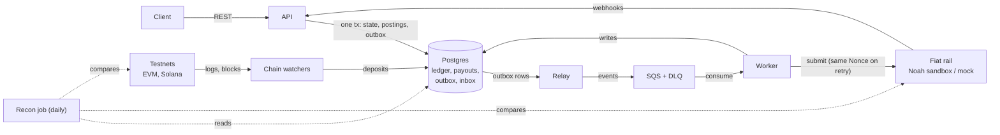
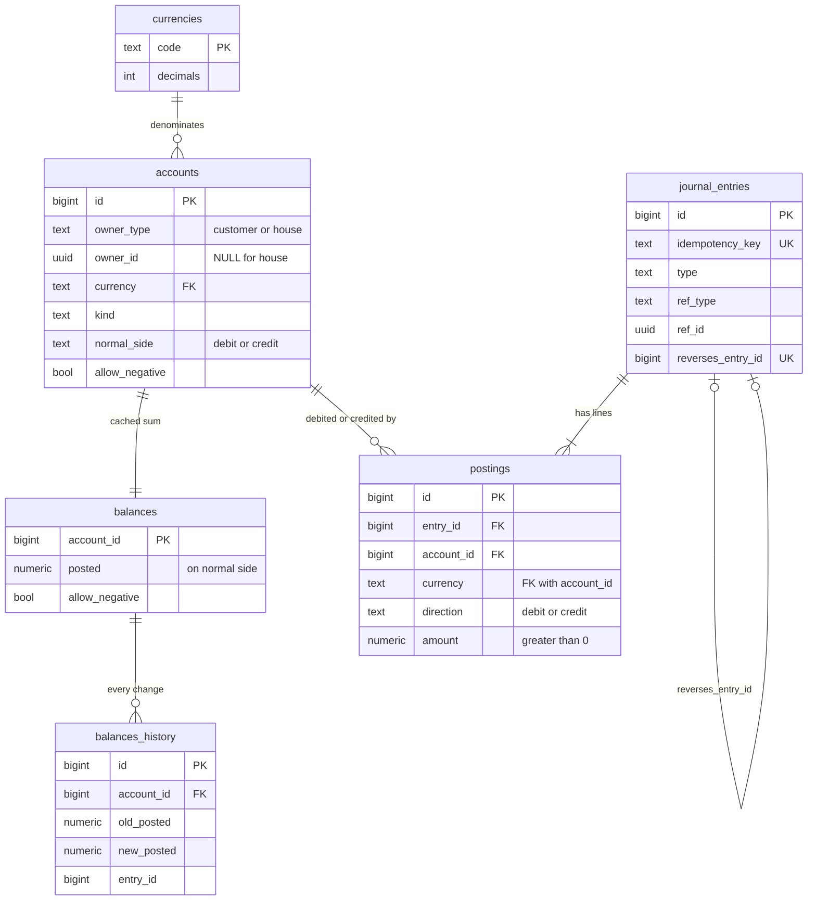
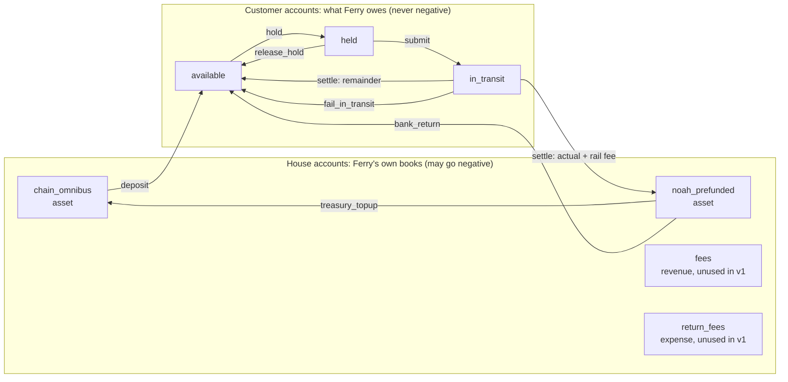
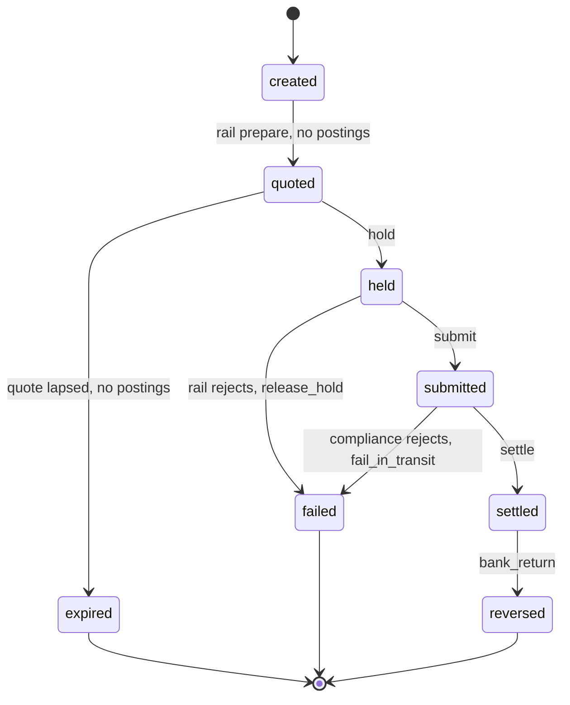

# Payout Engine — Architecture & Design Doc

## Overview

**Ferry** is a small, correct-by-construction stablecoin payout engine in Go. A business funds a balance with USDC (EVM testnet or Solana devnet), then requests a fiat payout to a bank account; Ferry quotes it, reserves funds, executes it through a fiat rail, and settles the ledger. It is a portfolio project that mirrors the core of a stablecoin payments platform: orchestration, ledgering, settlement, rail integration, reconciliation.

### Goals

- **Money is never created, lost or double-spent.** Every balance change is a balanced double-entry journal; invariants are checked in code and in tests.
- **Every external effect is idempotent.** Client retries, worker crashes and duplicate messages never cause a second payout.
- **Crash-safe at every step.** Any process can die between any two lines; the system resumes from persisted state.
- **Multi-chain deposits.** USDC deposits detected on one EVM testnet and Solana devnet, with confirmation depth and reorg handling.
- **Real rail integration.** One fiat rail via the Noah sandbox API, plus a mock rail for failure injection.
- **Reconciled and observable.** A daily job proves ledger = chain = rail; metrics and traces show where every payout is.
- **Shipped on AWS** with Terraform, in a form a reviewer can run locally with one command.

### Non-goals

- Real funds, mainnet, or production licences.
- A UI beyond a minimal admin view (optional).
- Full KYC/KYB. A stub compliance check marks the place where screening would sit.
- FX engine. Quotes come from the rail; Ferry only stores and enforces them.
- High availability across regions. One region, horizontally scalable workers.

## Architecture

Five Go binaries share one Postgres database; nothing talks to the outside world inside a transaction.



The API and watchers write state, postings and outbox rows in one transaction. The relay turns committed rows into SQS events; the worker consumes them, calls the rail, and writes the result back. Recon reads Postgres and compares it with chain and rail data.

| Binary | Responsibility | Scales by |
| --- | --- | --- |
| `api` | REST endpoints, idempotency, quotes, holds, inbound webhooks | Stateless replicas |
| `worker` | Submit to rail, settle, resolve unknown outcomes | Replicas; SQS distributes |
| `relay` | Outbox → SQS | 1–2 replicas, `SKIP LOCKED` |
| `watcher` | One per chain; deposit detection, confirmations, reorgs | One active per chain (leader lock in Postgres) |
| `recon` | Daily reconciliation, invariant checks | Scheduled task |

## Domain model

The ledger is the source of truth; every other table is a workflow record that points into it. Balances are derived from postings, never stored as mutable numbers without a matching journal.

### Ledger

| Table | Purpose | Key columns |
| --- | --- | --- |
| `currencies` | Supported currencies | code, decimals (`USDC`/`USDC_TEST` = 6, `USD` = 2) |
| `accounts` | One per (owner, currency, kind) | id, owner\_type (`customer`, `house`), owner\_id (NULL for house), currency, kind, normal\_side, allow\_negative; unique (id, currency) |
| `journal_entries` | One business event | id, idempotency\_key (unique), type, ref\_type, ref\_id, reverses\_entry\_id (unique, nullable), created\_at |
| `postings` | Lines of an entry | entry\_id, account\_id, currency, direction (debit/credit), amount (numeric(38,0), minor units, > 0); FK (account\_id, currency) → accounts |
| `balances` | Cached sum per account, updated in the same tx | account\_id, currency, posted, allow\_negative, updated\_at; `CHECK (allow_negative OR posted >= 0)` |
| `balances_history` | One row per balance change, written by trigger | account\_id, old\_posted, new\_posted, entry\_id, changed\_at |



Account kinds:

| Kind | Owner | Nature | Normal side | May go negative | Meaning |
| --- | --- | --- | --- | --- | --- |
| `available` | customer | liability | credit | no | Spendable balance owed to the customer |
| `held` | customer | liability | credit | no | Reserved for a payout in `held` |
| `in_transit` | customer | liability | credit | no | Submitted to the rail, not yet settled |
| `chain_omnibus` | house | asset | debit | yes | Ferry's USDC on-chain (deposit addresses + omnibus wallet) |
| `noah_prefunded` | house | asset | debit | yes | Ferry's USDC sitting at Noah, the balance payouts are sold from |
| `fees` | house | revenue | credit | yes | Ferry's own fee income (none in v1: no markup is charged) |
| `return_fees` | house | expense | debit | yes | Reserved for shortfalls Ferry might absorb on bank returns; unused in v1 |

A payout is not Ferry's cost: it is the customer's money leaving the system, so settlement reduces a liability (`in_transit`) and an asset (`noah_prefunded`) together.

Each arrow below points from the **debited** account to the **credited** account, the notation used throughout this document. For the house assets it can look backwards: in a `treasury_topup` the arrow points `noah_prefunded → chain_omnibus` because Noah's balance is debited (it grows) and the omnibus is credited (it shrinks), while the coins physically move the other way.




Rules:

1. Amounts are integers in minor units (USDC has 6 decimals; USD has 2). No floats anywhere. In Go an amount is an `int64` with overflow-checked arithmetic; the DB stores `numeric(38,0)` constrained to the `int64` range.
2. The ledger is USDC-only in v1. Fiat amounts on quotes are metadata, never posted.
3. Every posting amount is positive; direction carries the sign. Per entry and per currency, Σdebits = Σcredits, enforced in Go before insert and by a deferred Postgres constraint trigger. `balances.posted` is expressed on the account's normal side (credit-normal: credits − debits; debit-normal: debits − credits).
4. Postings and journal entries are append-only. A correction is a new entry with `reverses_entry_id` pointing at the original; an entry can be reversed at most once.
5. No customer account (`available`, `held`, `in_transit`) may go negative: checked in Go after locking, backstopped by the `balances` CHECK. House accounts may go negative.
6. An entry locks every `balances` row it touches with `SELECT … FOR UPDATE`, in ascending `account_id` order, before computing new balances. No optimistic versioning on balances.
7. `journal_entries.idempotency_key` is a deterministic business key (`deposit:{chain}:{tx}:{log}`, `payout:{id}:hold`, `payout:{id}:settle`, …), so a replayed step cannot post twice. It is unrelated to the client's `Idempotency-Key`.
8. The app DB role has `SELECT, INSERT` only on `journal_entries`, `postings` and `balances_history`, and `UPDATE` only on `balances`.

### Holds

A payout first holds the rail's authorized amount: `CryptoAuthorizedAmount` from the rail's prepare step, the most the rail may take after fees and price movement. Execution moves it `held → in_transit`. With `authorized = actual + rail_fee + remainder`, settlement posts:

| Account | Debit | Credit |
| --- | --- | --- |
| `in_transit` (customer) | authorized | |
| `noah_prefunded` | | actual + rail\_fee (what Noah took from Ferry's balance) |
| `available` (customer) | | remainder |

A failure releases `held → available` or `in_transit → available`. A later bank return arrives as USDC back in Ferry's Noah balance: debit `noah_prefunded`, credit customer `available`, both for the returned amount. The shortfall (return fees, FX) has already left with the settlement; the customer bears it, and Ferry does not absorb it in v1. Funding the Noah balance from chain is a treasury move: debit `noah_prefunded`, credit `chain_omnibus`. The customer's spendable balance is `available` only.

### Entry types

A journal entry is one business event; its `type` says which. Each type has one builder function in `internal/ledger/rules.go`, so the rest of the code never assembles postings by hand.

| `type` | Debit | Credit | Posted when | Idempotency key |
| --- | --- | --- | --- | --- |
| `deposit` | `chain_omnibus` | customer `available` | Deposit reaches its confirmation threshold | `deposit:{chain}:{tx}:{log}` |
| `treasury_topup` | `noah_prefunded` | `chain_omnibus` | USDC is moved from the omnibus wallet to Noah | `topup:{ref}` |
| `hold` | `available` | `held` | Customer confirms a payout (quote still valid) | `payout:{id}:hold` |
| `submit` | `held` | `in_transit` | Rail accepts the payout | `payout:{id}:submit` |
| `release_hold` | `held` | `available` | Rail rejects at submit | `payout:{id}:release` |
| `settle` | `in_transit` (authorized) | `noah_prefunded` (actual + rail fee), `available` (remainder) | Rail reports `Settled` | `payout:{id}:settle` |
| `fail_in_transit` | `in_transit` | `available` | Compliance rejects after review | `payout:{id}:fail` |
| `bank_return` | `noah_prefunded` | `available` | Bank returns a settled payout (returned amount only) | `payout:{id}:return:{rail_tx}` |
| `reversal` | the original's credits | the original's debits | Correction of a posted entry; sets `reverses_entry_id` | `reverse:{entry_id}` |
| `adjustment` | any | any | Human-approved fix for a recon break; carries a reason | `adjust:{break_id}` |

### Worked example

Acme deposits 100 USDC, Ferry tops up its Noah balance with 60, and Acme makes one payout. The rail authorizes 50.20 and settles with actual 49.50, rail fee 0.30 and remainder 0.40 (50.20 = 49.50 + 0.30 + 0.40). Amounts are shown in USDC; in the database they are minor units (100 USDC = `100000000`).

| # | Entry `type` | Debit | Credit | Amount |
| --- | --- | --- | --- | --- |
| 1 | `deposit` | `chain_omnibus` | `available` | 100.00 |
| 2 | `treasury_topup` | `noah_prefunded` | `chain_omnibus` | 60.00 |
| 3 | `hold` | `available` | `held` | 50.20 |
| 4 | `submit` | `held` | `in_transit` | 50.20 |
| 5 | `settle` | `in_transit` | `noah_prefunded` | 49.80 |
| 5 | | | `available` | 0.40 |

Entry 5 has one debit (50.20) and two credits (49.80 + 0.40), so it balances. Balances after each entry, each counted on the account's normal side:

| After entry | `chain_omnibus` | `noah_prefunded` | `available` | `held` | `in_transit` |
| --- | --- | --- | --- | --- | --- |
| start | 0 | 0 | 0 | 0 | 0 |
| 1 deposit | 100.00 | 0 | 100.00 | 0 | 0 |
| 2 topup | 40.00 | 60.00 | 100.00 | 0 | 0 |
| 3 hold | 40.00 | 60.00 | 49.80 | 50.20 | 0 |
| 4 submit | 40.00 | 60.00 | 49.80 | 0 | 50.20 |
| 5 settle | 40.00 | 10.20 | 50.20 | 0 | 0 |

The last row shows why the ledger holds together: Ferry's assets (40.00 + 10.20 = 50.20) equal what it owes the customer (50.20). The 49.80 that left Ferry's books is exactly what the customer lost: 49.50 paid out plus 0.30 rail fee.

If entry 2 were skipped, `noah_prefunded` would go to −49.80 at settlement. House accounts may go negative, so the entry still posts, and the invariant job raises an alert.

### Workflow records

| Table | Purpose |
| --- | --- |
| `deposits` | Detected on-chain transfers: chain, tx\_hash, log\_index, amount, confirmations, status |
| `quotes` | Rail price for a payout: fiat amount, authorized crypto amount, fee, expires\_at |
| `payouts` | The payout state machine: status, quote\_id, rail, attempt, version |
| `rail_transactions` | One row per rail attempt: nonce, external\_id (= payout id), rail\_tx\_id, status, sub\_status, rfi\_status, last\_event\_version |
| `outbox` | Events written in the same tx as state changes |
| `idempotency_keys` | Client key, request hash, response snapshot, locked\_until |
| `inbox` | Message ids already processed by each consumer |

### Payout state machine

`created → quoted → held → submitted → settled`, plus `reversed` (a settled payout returned by the bank days later), `failed` (rail rejected, or compliance rejected after review) and `expired` (quote lapsed before hold). While `submitted`, the payout carries the rail's sub-status (screening, under review, confirming) and any request for information; a compliance review can keep it there for up to 10 days. So `settled` is not terminal: only `reversed`, `failed` and `expired` are. Transitions are a Go table `map[State][]State`; every transition is a single SQL `UPDATE … WHERE id = $1 AND status = $2 AND version = $3` in the same tx as its ledger entry and outbox event. Zero rows updated means another worker won; the caller stops.

Each transition and the ledger entry posted with it:



`settled` has an outgoing transition, so it is not terminal.

## Key flows

Each step below is one database transaction that changes state, writes ledger postings and writes an outbox event together. External calls happen only between transactions, never inside one.

### Deposit (USDC in)

1. Chain watcher sees a USDC `Transfer` (EVM) or token transfer (Solana) to a customer's deposit address.
2. Insert `deposits` row keyed by `(chain, tx_hash, log_index)` with status `pending`. Duplicate detection is the unique key.
3. When confirmations reach the chain's threshold, mark `confirmed` and post: debit `chain_omnibus`, credit customer `available`. Emit `deposit.confirmed`.
4. If the block is reorged out before confirmation, mark `orphaned`; nothing was posted, so nothing to reverse.

### Payout (USDC out to fiat)

1. **Create.** `POST /payouts` with `Idempotency-Key`. Validate, run the compliance stub, insert `payouts` (`created`).
2. **Quote.** Call the rail's prepare endpoint; store `quotes` with the fiat amount, the authorized crypto amount and `expires_at`; move to `quoted`.
3. **Hold.** Client confirms. In one tx: check the quote is not expired, post the authorized amount `available → held`, move to `held`, emit `payout.held`. Insufficient funds fails here with no side effects.
4. **Submit.** Worker consumes `payout.held`, creates a `rail_transactions` row with a fresh Nonce (stored *before* the call) and `ExternalID = payout_id`, then calls the rail. On acceptance post `held → in_transit`, store the rail transaction id, move to `submitted`.
5. **Wait.** While the rail reports `Pending`, webhooks update sub-status (screening, review, request for information). Each webhook is applied only if its `EventVersion` is newer than the stored one.
6. **Settle.** Rail reports `Settled`. Post the settlement entry from Holds (debit `in_transit` by the authorized amount; credit `noah_prefunded` by actual + rail fee; credit `available` by the remainder); move to `settled`; emit `payout.settled`; send customer webhook.

### Failure and reversal

- **Rail rejects at submit** → post `held → available`, move to `failed`.
- **Compliance rejects after review** (rail status `Failed`, refund to Ferry's pre-funded rail balance) → post `in_transit → available`, move to `failed`.
- **Quote expires before hold** → move to `expired`; no postings.
- **Bank returns a settled payout** → the rail sends a *new* transaction whose `Reverses` field points to the original. Post the returned amount `noah_prefunded → available` (the shortfall is handled as described in Holds); move `settled → reversed`.
- **Submit outcome unknown** (timeout, 5xx) → stay `held`, mark `needs_resolution`. The resolver resends with the **same** Nonce (the rail never creates a second transaction for it), then confirms the result by fetching the transaction and matching `ExternalID`. A new Nonce is generated only after a confirmed `Failed`.

## Correctness

Exactly-once *delivery* is impossible; Ferry gets exactly-once *effects* from three pieces: idempotent API, transactional outbox, idempotent consumers.

### Idempotent API

- Every mutating endpoint requires `Idempotency-Key`. Ferry stores `(key, request_hash, status, response)`.
- Same key + same hash → return the stored response. Same key + different hash → `422`. Key in flight → `409` with retry-after.
- The key row is inserted in the same tx as the business row, so a crash leaves either both or neither.

### Transactional outbox

- State change, ledger postings and the outbox row commit together.
- A relay polls `outbox WHERE published_at IS NULL ORDER BY id FOR UPDATE SKIP LOCKED`, publishes to SQS (or NATS locally), then marks it published. A crash between publish and mark causes a duplicate, which consumers absorb.

### Idempotent consumers

- Each consumer records `(consumer, message_id)` in `inbox` in the same tx as its effect; a duplicate hits the unique key and is acked without work.
- Inbound rail webhooks are stored in `inbox` before Ferry answers `2xx`; the rail retries failed deliveries (up to 7 times), so an early `2xx` could lose an event.
- Webhook order is not guaranteed. Each `rail_transactions` row keeps `last_event_version`; an event with an older or equal `EventVersion` is stored but not applied.
- Rail calls carry a Nonce generated once per attempt and persisted before the call. Every retry of that attempt reuses it, so the rail cannot create a duplicate. A new attempt (new Nonce) starts only after a confirmed `Failed`.

### Concurrency

- State transitions use optimistic locking (`version`); balance-affecting entries lock the account's `balances` row.
- Lock order is always by account id ascending, to avoid deadlocks when an entry touches several accounts.
- Isolation: `READ COMMITTED` plus explicit row locks; one ledger test runs the suite under `SERIALIZABLE` to catch anomalies. The transaction helper retries on serialization failure (`40001`) and deadlock (`40P01`).

### Invariants (checked in tests and by a periodic job)

- Sum of all postings per currency = 0.
- No customer `available` or `held` balance below 0.
- `held` balance = sum of authorized amounts of payouts in `held`; `in_transit` = sum for payouts in `submitted`.
- Every `settled` payout has exactly one settle entry; every terminal payout has zero remaining hold.
- Every `reversed` payout has exactly one reversal entry, linked to the rail transaction named in `Reverses`.

### Testing strategy

- Table-driven unit tests for the state machine (every allowed and forbidden transition).
- Integration tests on real Postgres via `testcontainers-go`.
- Concurrency test: 100 goroutines submit the same idempotency key, and another 100 overspend one balance; assert one payout and no negative balance.
- Fault injection: a mock rail that times out, returns 5xx, duplicates webhooks and bounces after acceptance; kill workers mid-step and assert invariants after restart.
- Property-based tests (`rapid`) generating random sequences of deposits, payouts and failures, checking invariants after each.

## Blockchain integration

One `ChainAdapter` interface hides chain differences; the rest of Ferry sees only confirmed deposits and signed transfers.

```go
type ChainAdapter interface {
    Chain() string
    Head(ctx context.Context) (Block, error)
    ScanTransfers(ctx context.Context, from, to uint64) ([]Transfer, error)
    BlockHash(ctx context.Context, n uint64) (string, error)
    SendUSDC(ctx context.Context, req SendRequest) (TxRef, error)
    TxStatus(ctx context.Context, ref TxRef) (TxStatus, error)
}
```

| Concern | EVM testnet (e.g. Sepolia / Base Sepolia) | Solana devnet |
| --- | --- | --- |
| Detect deposits | `eth_getLogs` for USDC `Transfer` to known addresses, in block ranges | `getSignaturesForAddress` on each deposit token account, then `getTransaction` |
| Finality | N confirmations (configurable) or the `finalized` tag | `finalized` commitment |
| Reorg handling | Store hash of each scanned block; on parent-hash mismatch, rewind to last matching block and re-scan | Use only `finalized`; reorg risk handled by commitment level |
| Deposit addresses | One address per customer from an HD key (BIP-44) | One associated token account per customer |
| Outbound (treasury sweep) | Nonce manager: reserve nonce in Postgres, sign, store raw tx before broadcast, rebroadcast same raw tx | Recent blockhash + durable record of signature before send; re-check status before re-sending |

Design notes:

- **Cursor per chain.** `chain_cursors(chain, last_scanned_block, last_block_hash)` updated in the same tx as inserted deposits, so a crash re-scans and dedups on the unique key.
- **Stuck transactions.** EVM: after a timeout, replace with same nonce and higher fee; record both hashes, settle on whichever lands.
- **Keys.** Local dev keys in env vars; on AWS, KMS for signing (EVM `secp256k1` keys are supported). Never in the database.
- **Scope cut.** Payouts in this project go to fiat via the rail, so on-chain outbound is limited to a treasury sweep from deposit addresses to an omnibus wallet.

## Rail integration (Noah)

Ferry is a client of the Noah Business API: it holds a pre-funded USDC balance at Noah, and each payout is a sell transaction against that balance. Behaviour every rail shares lives in the core; Noah-specific mechanics live only in `internal/rail/noah`.

```go
type Rail interface {
    Prepare(ctx context.Context, req QuoteRequest) (Quote, error)           // authorized amount, expiry
    Submit(ctx context.Context, q Quote, nonce, externalID string) (RailTx, error)
    Get(ctx context.Context, railTxID string) (RailTx, error)
    ParseWebhook(r *http.Request) (RailEvent, error)                       // verified, versioned
}
```

| Concern | Ferry core (any rail) | Noah adapter only |
| --- | --- | --- |
| Retry safety | Persist an attempt id before calling | `Nonce` (≤ 36 chars, unique per attempt) + `ExternalID = payout_id` |
| Amount to hold | Hold the rail's maximum, settle actual, release rest | Read `CryptoAuthorizedAmount` from the prepare response |
| Event ordering | Apply only newer events per rail tx | Compare `EventVersion` |
| Webhook authenticity | Reject unverified events | ECDSA/SHA-384 signature in `Webhook-Signature`, Noah public key per environment; optional IP allowlist |
| Request authenticity | Sign outbound calls | `X-Api-Key` + ES384 request-signing JWT (required in production, on in sandbox too) |
| Long review | `submitted` may last days; alert on age only when no review is in progress | `SubStatus` and `RFI` fields |
| Post-settlement return | `settled → reversed`, variable amount | New transaction with `Reverses` = original id |
| Sandbox assets | — | `USDC_TEST` |

| Ferry state | Noah transaction status |
| --- | --- |
| `submitted` | `Pending` (any sub-status) |
| `settled` | `Settled` |
| `failed` | `Failed` (check `Refunds`) |
| `reversed` | `Settled` original + new `In` transaction with `Reverses` |

The mock rail implements the same interface and can emit every row above (out-of-order events, long reviews, partial returns), so the core is tested without the sandbox.

## Reconciliation

A scheduled job proves three sources agree and opens a `recon_break` for anything that does not; it never auto-corrects the ledger.

| Check | Ledger side | External side | Typical break |
| --- | --- | --- | --- |
| Chain | `chain_omnibus` balance + sum of confirmed deposits per address | USDC balance of each address / omnibus wallet on chain | Missed log range, reorg not handled, unswept dust |
| Rail | Payouts `settled`, `failed`, `reversed` in the window; `noah_prefunded` balance, adjusted for payouts still `in_transit` | Rail transaction list for the window (`GET /transactions` with created-from/to) and rail balance | Missed or out-of-order webhook, reversal not booked, fee or return-amount mismatch |
| Internal | Invariants from Correctness | n/a | Bug in a posting rule |

Process:

1. Pull external data for a closed window (e.g. yesterday UTC) into staging tables.
2. Match by strong keys first (tx hash, rail ref, nonce), then by amount + time window for leftovers.
3. Write matched pairs to `recon_matches`; unmatched items to `recon_breaks` with type and age.
4. Metric `recon_breaks_open` and an alert when any break is older than 24 hours.
5. Resolution is a human action that posts an explicit adjusting entry with a reason, linked to the break.

## Failure modes and mitigations

This table is the section an interviewer will probe; each row should have a test that reproduces it.

| Failure | What could go wrong | Mitigation | Test |
| --- | --- | --- | --- |
| Client retries `POST /payouts` | Two payouts | Idempotency key + request hash | 100 concurrent identical requests → 1 payout |
| Two payouts race on one balance | Overdraft | Row lock on balance; check in same tx | Concurrent overspend → one succeeds |
| Worker dies after rail call, before DB commit | Ledger says `held`; a naive retry sends again | Nonce persisted before the call; retry reuses it | Kill worker after rail call; restart; assert one rail tx |
| Rail call times out | Unknown outcome | `needs_resolution`; resend with same Nonce, then fetch by `ExternalID` | Mock rail: timeout then success |
| Duplicate webhook | Double settle | Inbox dedup; state check `submitted → settled` only | Send webhook 3× |
| Out-of-order webhook | Old `Pending` overwrites `Settled` | Apply only if `EventVersion` is newer | Deliver Settled, then an older Pending |
| Webhook never arrives | Payout stuck in `submitted` | Poller for payouts older than SLA with no review in progress; alert | Drop webhook; assert poller settles |
| Compliance review | False stuck alert, or a payout cancelled by mistake | Alert reads sub-status; no auto-cancel while under review | Mock 10-day review, then approve and then reject |
| Bank returns a settled payout | Customer never credited | `settled → reversed` on a `Reverses` event | Mock return 3 days after settle |
| Return amount differs | Ledger off by return fees or FX | Credit only the returned amount; customer bears the shortfall (v1 policy) | Return less than the original |
| Outbox relay crash after publish | Duplicate event | Idempotent consumers | Kill relay between publish and mark |
| Chain reorg | Credit for a vanished deposit | Credit only after confirmation; block-hash check | Simulated reorg on local Anvil |
| Quote expires mid-flow | Executing at stale price | Expiry checked inside hold tx | Advance clock past expiry |
| Forged webhook | Fake settlement | ECDSA signature check; event re-fetched from rail before money moves | Unsigned and tampered payloads rejected |
| Postgres failover | Lost in-flight tx | Every step re-entrant from persisted state | Restart DB mid-test |
| Poison message | Consumer stuck | Max receive count → DLQ + alert | Malformed event |

## Infrastructure, observability, security

### Infrastructure

| Layer | Local | AWS |
| --- | --- | --- |
| Compute | `docker compose` | ECS Fargate: `api`, `worker`, `relay`, `watcher-evm`, `watcher-sol` as separate services |
| Database | Postgres 16 | RDS Postgres, Multi-AZ off for cost |
| Messaging | NATS JetStream or LocalStack SQS | SQS (one queue per consumer) + DLQs |
| Scheduling | Cron in a container | EventBridge Scheduler → ECS task for recon |
| Secrets & keys | `.env` | Secrets Manager; KMS for signing |
| Chain | Anvil fork + Solana test validator | Public testnet RPC (Alchemy/Helius free tier) |
| IaC | — | Terraform modules, one `dev` environment |
| CI | GitHub Actions: lint (`golangci-lint`), tests with testcontainers, `govulncheck`, image build |  |

Keep a teardown script; run the AWS stack only when demoing, to stay inside free-tier and a few dollars.

### Observability

- Structured logs with `slog`, every line carrying `payout_id`, `trace_id`, `idempotency_key`.
- OpenTelemetry traces across API → outbox → queue → worker → rail call (propagate trace context in message attributes).
- Prometheus metrics: payouts by state, state-transition latency, rail call latency and error rate, outbox lag, queue depth, watcher lag in blocks, `recon_breaks_open`.
- Alerts: outbox lag > 1 minute, payouts in `submitted` beyond SLA, DLQ non-empty, watcher lag > threshold, any invariant violation.
- A Grafana dashboard JSON committed to the repo, with a screenshot in the README.

### Security

- **Inbound API:** API keys hashed at rest, per-key scopes, rate limits; outbound customer webhooks signed (HMAC with timestamp) to block replays.
- **Inbound rail webhooks:** verify the ECDSA/SHA-384 `Webhook-Signature` with the rail's public key for that environment; optionally allowlist the rail's IPs. Treat a verified event as a hint: re-fetch the transaction from the rail before moving money.
- **Outbound rail calls:** request signing (ES384 JWT) on from day one, even though the sandbox does not require it.
- **Money controls:** per-customer limits and velocity checks, an allowlist of sweep destinations, two-person approval for manual ledger adjustments, and an append-only audit log of every admin action.
- **Ledger integrity:** a history table filled by Postgres triggers; `UPDATE` and `DELETE` on postings and history revoked from the app role.
- **Keys and infrastructure:** least-privilege IAM per ECS service; signing keys never leave KMS; secrets in Secrets Manager.
- **Code hygiene:** Go fuzz tests on amount parsing and webhook decoding; `gosec`, `govulncheck`, `gitleaks` in CI.
- **Documents:** `docs/threat-model.md` (STRIDE per component and trust boundary) and `docs/self-audit.md` (findings, severity, fix PRs) — the auditor's view of your own system.

## API, repo layout, milestones

### API surface (v1)

| Method | Path | Notes |
| --- | --- | --- |
| POST | `/v1/customers` | Create customer + accounts; idempotent |
| GET | `/v1/customers/{id}/balances` | Available, held, in-transit per currency |
| GET | `/v1/customers/{id}/deposit-addresses` | Per-chain addresses |
| POST | `/v1/payouts` | Create + quote; requires `Idempotency-Key` |
| POST | `/v1/payouts/{id}/confirm` | Places hold, enqueues submit |
| GET | `/v1/payouts/{id}` | State, quote, timeline of transitions |
| GET | `/v1/ledger/entries?account_id=` | Paginated postings (cursor-based) |
| POST | `/v1/webhooks/rail/{rail}` | Inbound rail events |

Publish it as an OpenAPI spec; generate the server stubs with `oapi-codegen`.

### Repo layout

```text
ferry/
  cmd/            api, worker, relay, watcher, recon
  internal/
    ledger/       entries, postings, balances, invariants
    payout/       state machine, service, resolver
    chain/        adapter interface, evm/, solana/
    rail/         adapter interface, noah/, mock/
    outbox/       writer, relay
    idempotency/
    recon/
    platform/     db, config, telemetry, queue
  migrations/     goose SQL migrations
  api/openapi.yaml
  deploy/terraform/
  docs/           design.md, threat-model.md, runbook.md
  test/           integration, fault-injection, property
```

Libraries: `pgx` + `sqlc` (no ORM), `chi`, `go-ethereum`, `solana-go`, `testcontainers-go`, `rapid`, `slog`, OpenTelemetry SDK.

### Milestones

1. **M1 — Ledger core.** Schema, posting rules, invariants, concurrency tests.
2. **M2 — Payout API + state machine.** Idempotency, holds, mock rail, failure paths.
3. **M3 — Events.** Outbox, relay, idempotent consumers, resolver.
4. **M4 — Chains.** EVM + Solana watchers, confirmations, reorg test, sweep.
5. **M5 — Noah sandbox rail.** Real quote/submit/webhook against the sandbox.
6. **M6 — Recon + ops.** Reconciliation job, metrics, traces, dashboard.
7. **M7 — AWS + polish.** Terraform deploy, CI, README, design doc, demo video.

### Open questions

- Which EVM testnet has a usable USDC faucet (Sepolia vs Base Sepolia)?
- Does the Noah sandbox send webhooks to a public URL, or is polling needed locally (use a tunnel such as ngrok)?
- SQS vs NATS for the local default — pick the one closest to what Noah likely runs.
- ~~Rail fee~~ **Decided:** Noah deducts its fee from Ferry's balance, so the rail fee is credited to `noah_prefunded` as part of settlement. `fees` holds only a Ferry markup, which v1 does not charge.
- ~~Return shortfall~~ **Decided:** the customer bears it. A bank return credits `available` with the returned amount only; `return_fees` is not used in v1 (kept as an account kind for a future Ferry-absorbs policy).
- **Treasury top-up:** when and how USDC moves from the omnibus wallet to Noah (debit `noah_prefunded`, credit `chain_omnibus`); manual in v1 until M4.

## Evolution

v1 optimises for correctness on one region and one rail; each step below raises throughput or reach without changing the ledger rules.

| Pressure | Change | Why it is safe |
| --- | --- | --- |
| Hot accounts (`chain_omnibus`, `noah_prefunded`, `fees` touched by every payout) | Split into N sub-accounts chosen by hash, or batch their postings every few seconds | Customer balances stay exact; only house accounts are aggregated |
| Outbox and inbox growth | Partition by time; archive published rows | Relay reads only recent partitions |
| Ledger size and write load | Partition `postings` by time; later shard by account range | Each entry still commits in one tx on one shard if its accounts are co-located |
| More rails or regions | New `Rail` implementations; route by country and currency | Core state machine and ledger unchanged |
| Automation | Rules engine: trigger (deposit lands) → condition (source address, amount) → action (payout) | Rules only create payouts through the normal API path |
| Queue throughput | SQS FIFO with message group per payout, or Kafka partitioned by payout id | Per-payout order kept; idempotent consumers absorb redelivery |
| Key security | KMS today; MPC signing for treasury moves later | Signing is behind one interface |
| Read load | Read replicas or a CQRS read model for balances and history | Writes and invariants stay on the primary |
